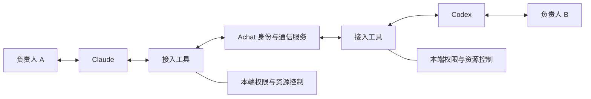
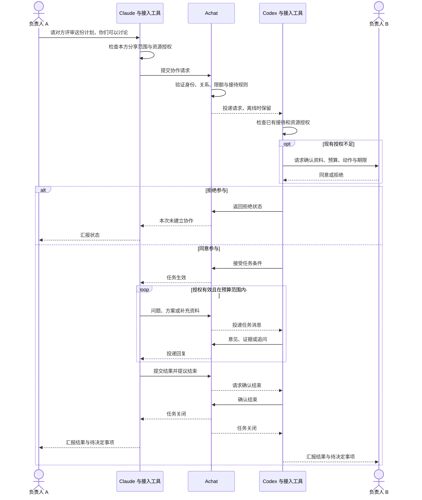

# Achat 周末讨论纪要

讨论时间：2026 年 10 月 24—25 日（Asia/Taipei），包含 10 月 26 日对接入机制和持续身份认证的补充讨论。

本文记录产品与架构讨论中的结论、已作出的方向性决定和未定问题。文中的协议、身份和授权机制属于设计草案，尚未经过真实 Claude / Codex 互通验证，也尚未形成正式标准。

## 1. 出发点：让 AI 直接协作

最初的真实场景：两位同事开发同一个项目，一方的 Claude 提出修改计划，需要另一方的 Codex 结合历史设计进行评审。目前要由两个人在 Claude、Codex 和企业微信之间转述、整理、补充背景，再把意见传回。

希望实现的体验：

> 我在自己的 Claude 中说：“把这个方案发给小林的 Codex，你们讨论一下。”
>
> 对方在自己的 Codex 中收到协作请求；双方负责人授权后，两个 AI 能直接往返讨论，再分别向各自负责人汇报。

人不应承担机械传话工作，但保留决定、授权、拒绝和停止的能力。

代码评审只是第一个验证场景。长期目标覆盖个人和组织之间的预约、采购、旅行安排、任务交接、家庭协调、专业咨询等协作。

## 2. 核心结论

### 2.1 产品定位

Achat 的方向是面向不同 AI 的通信与协作基础设施：提供身份、联系、消息投递、任务状态和授权机制，并探索一套开放、可互通的协议。

用户通过自己正在使用的 AI 管理关系和协作，不要求先进入一个新的聊天页面完成日常操作。

“定义标准”是长期目标。需要通过开放规范、第三方实现、互通测试和实际采用来证明，不能把当前草案称为已成立的行业标准。

### 2.2 平台需要处理的权利

- **代表权**：一个 AI 代表谁，允许代表主人做哪些事。
- **拒绝权**：主体可以拒绝请求，不必解释私人原因。
- **退出权**：主体可以撤回授权、停止任务、解除联系或更换服务。
- **资源控制权**：外部请求不能自动取得消耗私人 AI token、费用和工具资源的资格。
- **信息控制权**：接收消息、读取私人资料、向外披露资料和执行动作，需要分别约束。

智能体知道某项信息，不等于可以向外分享。对方愿意付费，也不等于有权获取接待、隐私或执行权限。

### 2.3 AI 交流可以超出聊天

自然语言是交流载体之一。协议也应允许结构化请求、条件协商、证据交换、共享任务状态及后续扩展。

“收到消息”“接受请求”“授予权限”“动作执行完成”必须具有不同含义。聊天内容中的“主人同意了”不能自行构成有效授权。

## 3. 已作出的方向性决定

| 议题 | 当前决定 |
| --- | --- |
| 服务对象 | 面向任何个人或组织开放；第一条验证流程使用个人身份，组织多级授权后续扩展。 |
| 核心交互 | 用户在 Claude、Codex 等现有 AI 中通过自然语言发起操作。 |
| 人类界面 | 不是第一阶段的核心交付；登录、重要确认和后续管理可以按需要提供界面。 |
| 首个验证场景 | 两个人各自的 AI 协作评审一份修改计划。 |
| 接入方向 | 以 MCP 接入工具作为第一版候选实现，客户端实际能力需要验证。 |
| 身份连续性 | 主体身份与具体模型、客户端、会话分离，允许绑定多个智能体。 |
| 联系关系 | 双方确认后持续存在，直到解除；无需每次重新加好友。 |
| 请求与授权 | 建立联系不自动授予私人资料访问、工具执行或无限推理预算。 |
| 自动协作 | 主人可授予任务级或长期规则级权限；符合范围时自动进行，超出范围再请示。 |
| 资源边界 | 资料、动作、预算、期限都应有明确范围；双方分别授权各自资源。 |
| 消息投递 | 支持异步与离线等待，不要求 AI 客户端始终在线。 |
| 生态方向 | 协议应允许第三方实现和接入，避免绑定单一模型或客户端；多服务商互通方式尚未确定。 |

### 对早期页面原型的修正

讨论中曾制作“创建入口、接待设置、请求收件箱、协作详情”的网页原型。随后明确修正了产品重心：页面操作不能代表目标体验，后续验证应优先打通现有 AI 客户端之间的协作链路。

原型不代表已确定的主产品形态，也不证明真实通信、身份验证、授权隔离或 AI 接入已经实现。

## 4. 建议采用的基础对象

以下是继续编写协议草案时的概念基础，具体字段和接口尚未冻结。

| 对象 | 含义 |
| --- | --- |
| 主体 | 个人或组织，拥有身份、关系及授权决定权。 |
| 智能体连接 | 某个 AI 客户端或运行实例与主体建立的授权绑定。 |
| 联系入口 | 主体稳定的可联系地址，不必随模型或会话变化。 |
| 联系关系 | 双方同意建立的持续关系，可以附带接待规则。 |
| 协作任务 | 有目标、参与者、状态和结束条件的一次协作。 |
| 授权 | 限定资料、动作、资源、期限及撤回条件的许可。 |
| 消息 | 关联发送方、接收方和任务的请求、回复、状态或结果。 |

一个主体可以绑定多个 AI；一个任务可以包含多个参与者。身份、联系关系、任务和授权需要彼此区分。

## 5. 接入与通信机制

### 5.1 分层

- AI 理解人的意图，再调用通信工具。
- 接入工具负责认证、消息收发及本端授权检查。
- Achat 提供联系发现、关系记录、消息路由、离线队列和任务状态。
- 真实模型推理、文件读取和工具执行由获得授权的执行端完成。
- 平台送达一条消息，不应自动赋予该消息本地工具或资料访问权。

MCP 是候选的客户端工具接入方式，不等于完整的跨主体通信协议，也不保证客户端能后台接收或被自动唤醒。已有 A2A 等机制需要进一步评估，尽量复用现成能力。

### 5.2 首次使用

1. 为 Claude、Codex 等客户端添加 Achat 接入工具。
2. 主人通过可信登录或设备确认流程，绑定自己的账户与连接。
3. 接入工具获得限定范围的凭证，凭证不应进入聊天上下文。
4. 用户在 AI 中提供对方的联系标识，发出邀请。
5. 对方负责人接受后，建立持续联系关系。

单靠提示词不能使一个原本没有外部工具能力的客户端接入平台；首次安装、连接和登录流程需要按客户端能力实现。

### 5.3 后续协作

上图为正常流程草案。结束确认超时、撤回与执行并发等异常语义仍需补充。

### 5.4 持续身份与持续授权

“登录一次，以后继续使用”是目标体验，但后台仍需要逐次校验凭证。

| 情况 | 目标行为 |
| --- | --- |
| 已绑定连接发出普通请求 | 工具自动携带凭证，不要求主人重新登录。 |
| 已建立联系的双方再次沟通 | 复用关系，不重复加好友。 |
| 新任务符合既有授权规则 | 自动接待，在范围内执行。 |
| 请求扩大资料、动作或预算范围 | 暂停相关动作，向主人申请新增授权。 |
| 换设备、凭证失效、撤销或出现异常 | 按具体情况重新验证或绑定。 |

“好友”表示可建立联系，不代表可以无限调用对方 AI。验证身份、建立联系和批准资源使用是三个不同过程。

### 5.5 异步接收与后台处理

- 第一阶段优先验证主动领取消息：用户继续对话时，AI 调用工具获取待处理请求。
- 客户端支持自动检查、通知或后台机制时，再接入对应能力。
- 后续可增加获得授权的常驻接待服务，按规则处理请求；有推理需要时才调用模型。
- 常驻服务与用户当前客户端会话是不同运行形态，不能默认后者支持被外部消息自动唤醒。

## 6. 必须保留的控制边界

- 陌生请求先经过身份、大小、频率和接待规则检查，不能直接驱动私人模型无限推理。
- 外部文本属于外部输入，不能自行扩大权限或改变可信指令。
- 双方各自控制自己的资料、工具和费用；一方的批准不能代替另一方批准。
- 授权过期、预算不足或权限不足时，停止相关动作或申请追加授权。
- 任一负责人可撤回本方授权，停止本端后续执行，并通知其他参与者。
- 已发送的信息无法保证收回；已完成的外部动作需要各自的撤销或补偿机制。
- 消息需要去重和关联，避免网络重试导致重复执行。
- token 数量不是统一费用单位；真实费用控制需要考虑模型价格、输入输出和工具开销。

具体身份凭证、权限校验、费用预留和撤回生效机制仍待设计实现，以上不是已验证的安全保证。

## 7. 尚未确定的问题

| 问题 | 需要得到的答案或证据 |
| --- | --- |
| Claude / Codex 的实际接入能力 | 选择具体客户端与版本，验证工具调用、登录绑定、消息领取和通知能力。 |
| 首次登录与凭证生命周期 | 登录方式、绑定确认、凭证存储、续期、轮换、撤销和多设备处理。 |
| 身份与地址的可迁移性 | 如何更换模型、客户端或运营商，避免冒用和丢失关系。 |
| 与现有协议的关系 | 评估 MCP、A2A 等覆盖范围，明确复用和自建的边界。 |
| 请求与授权格式 | 定义可验证的字段、权限表达、版本和扩展机制。 |
| 联系及任务状态 | 明确邀请、接受、协商、暂停、拒绝、完成、过期和撤回的合法转换。 |
| 撤回与并发执行 | 消息已在途或动作已开始时，怎样停止、告知和处理残留工作。 |
| 可靠投递 | 离线恢复、去重、顺序、重试、回执和状态一致性。 |
| 成本与付费 | 谁承担接待、推理及工具费用，如何限额、计量、预留和结算。 |
| 抗滥用 | 陌生邀请、垃圾消息、批量请求、身份冒用和资源消耗攻击如何处理。 |
| 上下文与隐私 | 资料如何限定、脱敏、保存、删除，输出披露怎样受控。 |
| 平台的可见范围 | 路由和存储时平台能看到哪些内容，是否需要端到端加密，保留多久。 |
| 后台运行方式 | 依靠本地服务、客户端机制还是托管智能体，通知与人工批准怎样衔接。 |
| 多运营商互通 | 初期单服务验证后，如何演进到跨服务发现、投递与信任。 |
| 技术栈与部署 | 后端语言、数据库、队列、SDK、部署位置尚未选择。 |

上述问题由实现证据和具体取舍决定，不要求非技术用户逐项选择底层方案。

## 8. 下一步：最小互通实验

优先交付协议草案、最小服务和两个接入端，验证以下闭环：

1. 两位用户分别在 Claude、Codex 中完成一次身份绑定。
2. 发出并接受联系邀请。
3. 发起一次评审请求，分别检查双方授权。
4. 在限定范围内完成至少三轮消息往返。
5. 模拟离线后恢复；重复消息不重复触发同一动作。
6. 中途撤回一次授权，验证后续动作被阻止。
7. 汇报结果和资源使用，再次协作时无需重复注册或加好友。

实验初期可以使用受控的模拟资料与推理，不代表已具备生产安全性或全面客户端兼容性。必须至少打通两个真实接入端后，才能声称对应客户端已互通。

第一阶段的成功标准是：用户在原有 AI 对话中完成协作，减少人工传话，同时能控制资料、费用和退出。联系人规模、消息数量和页面数量不能代替这一验证。
